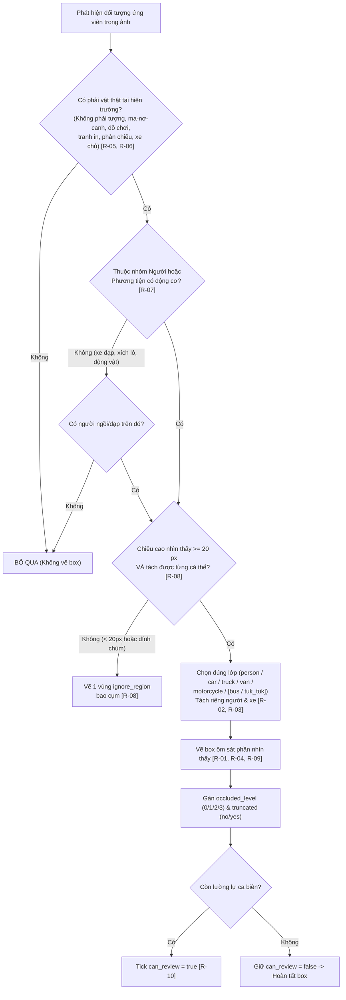

# Guideline gán nhãn — v0.1-105 (Bản cá nhân Pha 1) — Thành viên 105

- **Phiên bản:** `v0.1-105` (Phát triển độc lập từ `guideline/guideline_v0_starter.md` trong Pha 1)
- **Ngày:** `2026-11-16`
- **Người viết:** Thành viên `105` (Nhóm `T012`)
- **Loại nhãn:** Bounding box 2D (hộp chữ nhật trục song song ảnh) trên ảnh đường phố
- **Công cụ & Định dạng:** CVAT (vẽ Rectangle, không dùng cờ `Q`), xuất **COCO 1.0** (`Save images = OFF`)

---

## 0. Đặc tả Dự án Gán nhãn (`annotation_project` — Chuẩn `ground-truth-collector`)

Khối cấu hình YAML dưới đây chuẩn hóa toàn bộ phạm vi, schema nhãn, quy trình kiểm soát chất lượng (QC), đào tạo người gán, luồng công việc và chỉ số mục tiêu cho lô 40 ảnh Day 07:

```yaml
annotation_project:
  name: "Day07-Street-2D-Detection-T012-105"
  date: "2026-11-16"

  scope:
    data_type: "Image (RGB/Grayscale street-level JPEG, cạnh dài <= 1024 px)"
    task_type: "2D Bounding Box Object Detection"
    volume: "40 ảnh (img_001.jpg - img_040.jpg); K=3 lượt/ảnh cho nhóm 5 người = 120 lượt gán độc lập"
    timeline: "4 giờ thực hành (Pha 0 - Pha 6)"

  label_schema:
    # Đồng bộ 9 lớp theo cấu hình CVAT và taxonomy v1.0 (8 lớp đối tượng có đủ 3 thuộc tính + ignore_region)
    labels:
      - label: "car"
        definition: "Xe ô tô chở khách dưới 9 chỗ (sedan, hatchback, SUV, crossover, wagon, taxi)."
        examples:
          positive: ["img_012.jpg (Mazda CX-5 bạc)", "img_023.jpg (Honda Civic đen)", "img_024.jpg (AMC Pacer đen và xe cổ xung quanh)"]
          negative: ["img_038.jpg (xe mô hình đồ chơi trong tủ kính)", "img_020.jpg (xe phản chiếu trong gương chiếu hậu)", "img_024.jpg (khung vỏ xe vàng rỗng trên nóc xe)"]
        edge_cases: ["img_019.jpg (xe diễu hành DangerMouse có biển số YR04 NUM và người lái thật -> đề xuất gán car + tick can_review để nhóm chốt Pha 2)"]

      - label: "truck"
        definition: "Xe cơ giới thiết kế chở hàng có khoang/thùng hàng tách biệt hoặc bán tải (pickup), xe đầu kéo, xe chở xe."
        examples:
          positive: ["img_001.jpg (bán tải Suzuki)", "img_002.jpg (xe đầu kéo chở 8 ô tô)", "img_007.jpg (xe tải thùng Isuzu)", "img_036.jpg (xe tải nhẹ thùng bạt CMC Veryca)"]
          negative: ["img_027.jpg (tượng đài xe bán tải bằng đá granite)", "img_035.jpg (hàng bao tải chất cao trên nóc tuk-tuk không tính là thùng xe)"]
        edge_cases: ["img_037.jpg (bán tải GO Transit gắn nắp thùng cứng Master 75 -> xếp truck vì khung gầm bán tải)", "img_016.jpg (bán tải Mighty X lắp khung mui chở khách -> đề xuất truck + can_review)"]

      - label: "van"
        definition: "Xe thùng kín thân liền khối cỡ nhỏ hoặc trung dùng chở hàng nhẹ hoặc chở khách kiểu minibus/MPV chở khách (6-16 chỗ dạng thân liền)."
        examples:
          positive: ["img_005.jpg (xe van bạc 51LD-70-65)", "img_016.jpg (xe van hai tông màu trắng/xám)", "img_011.jpg (xe cấp cứu/van trắng phía xa)"]
          negative: ["img_037.jpg (bán tải gắn nắp thùng rời -> truck)", "img_009.jpg (xe khách/buýt thân dài >16 chỗ -> đề xuất bus)"]
        edge_cases: ["img_007.jpg (bán tải trắng cải tạo gắn thùng kín phía sau -> ưu tiên truck do đầu xe bán tải rõ rệt, cần thảo luận Pha 2)"]

      - label: "motorcycle"
        definition: "Xe cơ giới hai bánh (hoặc ba bánh gắn liền kiểu mô tô sidecar) có động cơ, gồm xe số, xe tay ga, mô tô phân khối lớn."
        examples:
          positive: ["img_005.jpg (xe tay ga Honda Lead, xe số)", "img_008.jpg (xe máy đậu và đang chạy)", "img_016.jpg (xe Vespa xanh)", "img_022.jpg (mô tô gắn thùng sidecar)"]
          negative: ["img_003.jpg, img_010.jpg, img_029.jpg (xe đạp thường không động cơ)", "img_006.jpg, img_023.jpg, img_034.jpg (xích lô đạp 3 bánh)"]
        edge_cases: ["img_011.jpg (mô tô độ trang trí tại lễ hội -> vẫn gán motorcycle)", "img_025.jpg (xe máy kéo thùng hàng gắn bên hông -> gộp chung cụm xe máy + khung kéo)"]

      - label: "person"
        definition: "Người thật đang hiện diện vật lý trong khung cảnh (người đi bộ, người ngồi, người lái xe, hành khách nhìn thấy)."
        examples:
          positive: ["img_001.jpg (phụ nữ đứng trước xe và khách ngồi bàn)", "img_005.jpg (người điều khiển và người ngồi sau xe máy)", "img_023.jpg (người đạp xích lô)"]
          negative: ["img_017.jpg (tượng đồng cưỡi ngựa)", "img_018.jpg (ảnh chân dung trên biển quảng cáo)", "img_033.jpg (ma-nơ-canh trong tủ kính)", "img_019.jpg (hình nộm chuột DangerMouse)"]
        edge_cases: ["img_011.jpg (nhân vật Predator đứng trên bệ đỏ -> loại vì là tượng/mô hình trưng bày, gắn can_review nếu nghi là người hóa trang)", "img_014.jpg (người đi xe máy bị nhòe chuyển động -> vẫn gán)"]

      - label: "bus"
        definition: "Xe buýt công cộng hoặc xe khách cỡ trung/lớn thân liền khối, cửa sổ hàng dài chuyên chở nhiều hành khách."
        examples:
          positive: ["img_009.jpg (xe khách/buýt màu kem 75H-2944)", "img_031.jpg (xe buýt số 62)", "img_037.jpg (hai xe buýt xanh GO Transit)", "img_040.jpg (xe buýt số 511)"]
          negative: ["img_005.jpg (xe van bạc 51LD-70-65 -> van)"]
        edge_cases: ["Đầy đủ 3 thuộc tính occluded_level, truncated, can_review giống các lớp xe khác."]

      - label: "three_wheeler"
        definition: "Xe ba bánh có động cơ chuyên chở khách/hàng (tuk-tuk Thái Lan, auto-rickshaw Ấn Độ) có khoang mui trần/mui bạt hở."
        examples:
          positive: ["img_004.jpg (2 xe tuk-tuk xanh)", "img_016.jpg (2 xe tuk-tuk)", "img_035.jpg (xe auto-rickshaw vàng chở bao tải)", "img_040.jpg (tuk-tuk vàng-xanh)"]
          negative: ["img_023.jpg, img_034.jpg (xích lô đạp không động cơ -> loại bỏ khỏi lớp xe)", "img_022.jpg (mô tô sidecar -> motorcycle)"]
        edge_cases: ["img_035.jpg (bao tải chất vượt nóc -> box three_wheeler chỉ ôm khung xe và mui cứng, không kéo theo khối bao tải rời phía trên)."]

      - label: "bicycle"
        definition: "Xe đạp hai bánh vận hành bằng bàn đạp không có động cơ (tách riêng với xe máy motorcycle và xích lô ba bánh)."
        examples:
          positive: ["img_003.jpg (xe đạp nam thanh niên dắt)", "img_010.jpg (xe đạp chở sọt phật thủ)", "img_029.jpg (xe đạp người chở thanh nhôm)", "img_039.jpg (xe đạp trên phố)"]
          negative: ["img_006.jpg, img_023.jpg, img_034.jpg (xích lô đạp 3 bánh -> ngoài phạm vi xe, chỉ gán person)", "img_005.jpg (xe tay ga -> motorcycle)"]
        edge_cases: ["Áp dụng đủ 3 thuộc tính occluded_level, truncated, can_review; tách riêng box person cho người đạp xe theo R-02."]

      - label: "ignore_region"
        definition: "Vùng bỏ qua không gán từng cá thể: đám đông người dày đặc, bãi xe chồng lấp hoặc cụm đối tượng có chiều cao < 20 px."
        examples:
          positive: ["img_019.jpg (hàng khán giả đứng sau rào chắn)", "img_021.jpg (biển xe máy dày đặc ở xa)", "img_030.jpg (hàng xe máy xếp sát nhau phía sau)", "img_032.jpg (hàng người chờ xe buýt xếp chồng lên nhau)"]
          negative: ["img_005.jpg (tuy đông nhưng các xe máy và người tiền cảnh tách biệt rõ, cao >> 20 px -> phải gán từng box riêng)"]
        edge_cases: ["Chỉ vẽ ignore_region khi thực sự không thể tách biên từng vật hoặc vật cao < 20 px; tránh dùng ignore_region để lấp liếm bỏ sót vật rõ ràng."]

  guidelines:
    document: "submission/guidelines/individual/guideline_105.md"
    key_rules:
      - "R-01: Box ôm sát 100% phần nhìn thấy của vật (Sai số biên <= 2-3 px); không suy đoán phần bị che khuất."
      - "R-02: Tách độc lập box person và box phương tiện (motorcycle / three_wheeler / bicycle) cho người ngồi/lái trên xe."
      - "R-03: Xe chở xe gán đồng thời 1 box truck cho xe chở và từng box car cho mỗi ô tô con trên sàn."
      - "R-04: Không kéo box phương tiện ôm hàng hóa rời quá khổ (bao tải, thanh nhôm); phụ kiện gắn cứng theo thân xe (nắp thùng Master 75) được tính vào xe."
      - "R-05: Loại bỏ hoàn toàn vật không thật (tượng, ma-nơ-canh, đồ chơi, ảnh in/biển quảng cáo, vỏ xe rỗng trưng bày)."
      - "R-06: Loại bỏ ảnh phản chiếu trong gương/kính/vũng nước và các bộ phận thuộc xe chủ (ego-vehicle)."
      - "R-07: Xe đạp hai bánh gán lớp bicycle (nếu thuộc taxonomy 9 lớp); xích lô 3 bánh không động cơ loại bỏ khỏi lớp xe nhưng vẫn gán person."
      - "R-08: Vật cao < 20 px hoặc cụm chồng lấp dày đặc không tách được -> bọc bằng ignore_region."
      - "R-09: Vật bị nhòe chuyển động (motion blur) vẫn gán nếu nhận diện chắc chắn lớp; ôm theo thân vật thực, không ôm vệt mờ kéo dài."
      - "R-10: Bất kỳ ca biên nào chưa có tiền lệ -> vẽ box tốt nhất và bật can_review=true, hoặc ghi submission/qc/image_issues.csv nếu chưa vẽ được."
    decision_tree:
      - condition: "Vật có phải đối tượng thật (không phải tượng, ma-nơ-canh, đồ chơi, tranh in, phản chiếu, bộ phận xe chủ)?"
        then: "Nếu KHÔNG -> Bỏ qua (không gán). Nếu CÓ -> Đi tiếp."
      - condition: "Vật có thuộc lớp trong taxonomy 9 lớp (person, car, truck, van, motorcycle, three_wheeler, bus, bicycle) không?"
        then: "Nếu KHÔNG (xích lô đạp 3 bánh, động vật) -> Bỏ qua phương tiện (nhưng vẫn xét người ngồi trên nó). Nếu CÓ -> Đi tiếp."
      - condition: "Chiều cao phần nhìn thấy >= 20 px VÀ tách biệt được ranh giới cá thể?"
        then: "Nếu KHÔNG (< 20 px hoặc đám đông/bãi xe dính chùm) -> Gộp vào ignore_region. Nếu CÓ -> Vẽ box riêng theo R-01..R-04 và gán đủ 3 thuộc tính."

  quality_control:
    inter_annotator_agreement:
      metric: "Pairwise IoU + Class Agreement (qc_compare.py); Cohen's Kappa (cặp 2 người) / Fleiss' Kappa (nhóm 5 người, K=3)"
      threshold: "Mean IoU >= 0.85 (ngưỡng ghép match_iou=0.5; IoU từng box >= 0.85 với box cao >= 50px, >= 0.70 với box < 50px); Class agreement >= 95%; Kappa >= 0.80"
    review_process:
      method: "4 lớp kết hợp: Consensus (K=3 mù độc lập) -> Adjudication/Calibration (họp giải quyết 100% ca flagged) -> Gold standard (đối chiếu ca tham chiếu coach sau khi khóa Pha 3) -> Expert review (duyệt toàn lô 40/40 ảnh tại Pha 6)"
      sample_rate: "100% toàn lô (40/40 ảnh) ở Pha 6 (qc_sample.py --round 1 mặc định; --n chỉ dùng demo và luôn Hold)"
    feedback_loop:
      - "Tự động xuất overlay work/viz/ và calibration_candidates.csv phân tách lỗi cá nhân vs lỗi guideline mơ hồ."
      - "Ghi vết 9 cột vào calibration_decisions.csv (case_id, rule_id, pham_vi=anh|lo) và nâng cấp guideline_v1.1_calibrated.md."
      - "Nếu có lỗi hệ thống/lặp (>= 3 lỗi cùng loại và >= 50% tổng lỗi) hoặc > 2% ảnh lỗi -> bắt buộc Rework về Pha 5 và mở round mới."

  labeler_training:
    onboarding:
      - "Bước 1 (30-60 phút): Đọc hiểu guideline và taxonomy, làm bài kiểm tra phân biệt ca thật vs ca loại (tượng/phản chiếu/xe đạp)."
      - "Bước 2 (1-2 giờ): Gán thử có hướng dẫn trên 20-50 ảnh mẫu (hoặc 10 ảnh đa dạng từ tập 40 ảnh) và nhận phản hồi trực tiếp."
    qualification:
      test: "Gán độc lập bộ chuẩn (30-50 vật / 10 ảnh đối chứng có người đi xe máy, xe chở xe, tượng, đám đông)"
      passing: ">= 90% đồng thuận với Gold Standard của coach/nhóm trưởng và 0 lỗi sai cấu trúc CVAT."

  workflow:
    tool: "CVAT (Rectangle + Export COCO 1.0, tắt Save images)"
    batching: "5 thành viên (101-105), K=3 người/ảnh qua split_assign.py --seed 42 -> 24 ảnh/người, tổng 120 lượt gán độc lập."
    escalation: "Tick can_review=true trên box lưỡng lự; ghi submission/qc/image_issues.csv (image, annotator, region, note) nếu chưa vẽ được box."

  metrics:
    throughput: "12-15 ảnh/giờ (~2 giờ hoàn thành 24 ảnh được giao nếu ảnh đông đúc)"
    quality: "Tỉ lệ ảnh có lỗi <= 2% (lô 40 ảnh: 0/40 ảnh lỗi mới đạt Release); 0 cờ can_review còn sót"
    consistency: "Mean IoU >= 0.85, Class Agreement >= 95%, Kappa >= 0.80 trước calibration"
```

---

## 1. Mục tiêu (`overview`)

1. **Mô tả bài toán (Task description):** Gán nhãn hộp giới hạn 2D (`bounding box`) cho các đối tượng **người và phương tiện cơ giới đường bộ** trên tập 40 ảnh đường phố thực tế (`data/images/img_001.jpg` đến `img_040.jpg`, cạnh dài tối đa 1024 px).
2. **Tại sao việc gán chuẩn xác lại quan trọng (Why this matters):** Chất lượng nhãn quyết định trần độ chính xác (model ceiling) của mô hình học sâu. Tập ảnh đường phố chứa nhiều tình huống biên phức tạp (xe ba bánh tuk-tuk, xe chở ô tô nhiều tầng, hàng hóa quá khổ, tượng, ma-nơ-canh, đồ chơi, phản chiếu gương, nhòe chuyển động). Bản `guideline_v0_starter.md` quá sơ sài khiến hai người gán chắc chắn hiểu khác nhau, làm nhiễu tập huấn luyện và sụt giảm độ đồng thuận IAA.
3. **Cách dữ liệu nhãn sẽ được sử dụng (How labels will be used):** Dữ liệu đầu ra chuẩn COCO 1.0 dùng để huấn luyện và đánh giá mô hình phát hiện vật 2D cho **camera giám sát giao thông thông minh (ITS)** và **hệ thống hỗ trợ lái/xe tự hành (ADAS/AV)**. Do đó, các sai sót sau gây hậu quả nghiêm trọng:
   - **False Negative (Bỏ sót vật thật):** Bỏ sót người đi bộ, người đi xe máy (`img_014.jpg`, `img_026.jpg`) hoặc ô tô nằm trên sàn xe chở xe (`img_002.jpg`) khiến hệ thống bỏ lỡ tác nhân tham gia giao thông, gây rủi ro tai nạn.
   - **False Positive (Gán nhầm vật giả):** Gán nhầm tượng người/xe (`img_017.jpg`, `img_027.jpg`), biển quảng cáo có chân dung (`img_018.jpg`), ma-nơ-canh (`img_033.jpg`), đồ chơi (`img_038.jpg`) hoặc xe phản chiếu trong gương chiếu hậu (`img_020.jpg`) khiến xe tự hành kích hoạt **phanh gấp giả (phantom braking)**.
   - **Box lỏng hoặc sai tách lớp:** Ôm cả hàng hóa cồng kềnh vào xe (`img_029.jpg`, `img_035.jpg`) hoặc gộp chung người với xe máy làm sai lệch ước lượng kích thước và khoảng cách an toàn của đối tượng.

---

## 2. Lớp và thuộc tính (`label_schema`)

### 2.1. Bảng định nghĩa Lớp (Classes)

> **Cập nhật đồng bộ 9 lớp (`taxonomy.json` `v1.0`):** Bộ lớp chuẩn hóa gồm `car`, `truck`, `van`, `motorcycle`, `person`, `ignore_region`, `three_wheeler`, `bus`, `bicycle`. Tất cả **8 lớp đối tượng** (trừ `ignore_region`) đều có đủ 3 thuộc tính `occluded_level`, `truncated`, `can_review`.

| Lớp | Định nghĩa (1–2 câu) | Tiêu chí nhận diện (Criteria) | Ví dụ dương tính (Positive — kèm ID ảnh) | Phản ví dụ / Dễ nhầm với (Negative) |
|---|---|---|---|---|
| `car` | Xe ô tô chở khách dưới 9 chỗ ngồi (sedan, hatchback, coupe, SUV, crossover, station wagon, taxi). | Có 4 bánh, thân xe thấp hoặc gầm cao dạng SUV, khoang hành khách và khoang động cơ/hành lý liền khối, không có thùng tải hở phía sau. | Ô tô đen Honda Civic (`img_023.jpg`); Mazda CX-5 bạc (`img_012.jpg`); 8 ô tô con trên sàn xe chở (`img_002.jpg`); xe cổ AMC Pacer (`img_024.jpg`). | Xe mô hình đồ chơi trong tủ kính (`img_038.jpg`); xe phản chiếu trong gương (`img_020.jpg`); vỏ xe rỗng trên nóc (`img_024.jpg`); xe bán tải có thùng hàng rời (`truck`). |
| `truck` | Xe cơ giới thiết kế chở hàng có khoang/thùng hàng tách biệt cabin, xe đầu kéo, xe chở xe hoặc xe bán tải (pickup). | Có cabin riêng và thùng hàng hở/kín phía sau tách biệt thân cabin, hoặc là dòng pickup truck (dù có gắn nắp thùng cứng). | Bán tải Suzuki (`img_001.jpg`); xe đầu kéo chở 8 ô tô (`img_002.jpg`); xe tải thùng Isuzu (`img_007.jpg`); xe tải nhẹ thùng bạt (`img_036.jpg`); bán tải gắn nắp Master 75 (`img_037.jpg`). | Tượng đài xe bán tải bằng đá (`img_027.jpg`); xe van thân liền (`img_005.jpg`); bao tải hàng hóa chất rời bên ngoài thân xe (`img_035.jpg`). |
| `van` | Xe thùng kín thân liền khối cỡ nhỏ hoặc trung (6–16 chỗ hoặc xe chở hàng nhẹ dạng minibus/MPV khoang kín). | Cabin và khoang sau nối liền một khối vuông vức (không phân tách đầu kéo/thùng rời như `truck`), thân ngắn hơn `bus`. | Xe van bạc `51LD-70-65` (`img_005.jpg`); xe van trắng-xám (`img_016.jpg`); xe van cứu thương trắng ở hậu cảnh (`img_011.jpg`). | Xe buýt thân dài nhiều hàng cửa sổ (`img_009.jpg`, `img_037.jpg`); bán tải gắn nắp thùng rời (`img_037.jpg` -> `truck`). |
| `motorcycle` | Xe cơ giới hai bánh (hoặc ba bánh dạng mô tô gắn sidecar) chạy bằng động cơ đốt trong hoặc động cơ điện. | Có động cơ, tay lái ghi-đông, lốp bản rộng hơn xe đạp, có biển số/ống xả/yếm xe. | Xe tay ga và xe số trên phố (`img_005.jpg`, `img_008.jpg`, `img_030.jpg`); Vespa xanh (`img_016.jpg`); mô tô gắn sidecar (`img_022.jpg`); xe máy độ (`img_011.jpg`). | Xe đạp thường không động cơ (`img_003.jpg`, `img_039.jpg` -> `bicycle`); xích lô đạp (`img_006.jpg`, `img_023.jpg`); xe tuk-tuk 3 bánh có mái che (`img_004.jpg` -> `three_wheeler`). |
| `person` | Người thật đang hiện diện vật lý trong không gian ảnh (người đi bộ, đứng, ngồi, người lái hoặc hành khách trên mọi loại xe). | Cơ thể người thật bằng xương thịt, tách biệt khỏi vật trưng bày/ảnh in. | Phụ nữ đứng cạnh bán tải và khách ngồi quán (`img_001.jpg`); người đi xe máy (`img_005.jpg`, `img_026.jpg`); người đi bộ (`img_014.jpg`, `img_025.jpg`); người đạp xích lô (`img_023.jpg`, `img_034.jpg`). | Tượng đồng (`img_017.jpg`); ma-nơ-canh (`img_033.jpg`); ảnh trên biển quảng cáo (`img_018.jpg`, `img_030.jpg`, `img_040.jpg`); nhân vật bông DangerMouse (`img_019.jpg`); tượng Predator (`img_011.jpg`). |
| `three_wheeler` | Xe cơ giới 3 bánh có khoang hở và mái che đặc trưng chở khách/hàng (tuk-tuk, auto-rickshaw). | 1 bánh trước + 2 bánh sau, buồng lái hở gắn mái bạt/kim loại, có động cơ và biển số. | Hai xe tuk-tuk xanh (`img_004.jpg`); 2 xe tuk-tuk (`img_016.jpg`); xe auto-rickshaw vàng chở bao tải (`img_035.jpg`); tuk-tuk (`img_040.jpg`). | Xích lô đạp không động cơ (`img_006.jpg`, `img_023.jpg`); mô tô gắn sidecar lệch bên (`img_022.jpg` -> `motorcycle`). |
| `bus` | Xe buýt công cộng hoặc xe khách thân dài chuyên chở hành khách (> 16 chỗ). | Thân xe chữ nhật dài, trần cao, dãy cửa sổ dài dọc thân, cửa lên xuống hành khách cỡ lớn. | Xe khách/buýt kem `75H-2944` (`img_009.jpg`); xe buýt số 62 (`img_031.jpg`); hai xe buýt xanh GO Transit (`img_037.jpg`); xe buýt số 511 (`img_040.jpg`). | Xe van cỡ nhỏ dưới 16 chỗ (`img_005.jpg` -> `van`). |
| `bicycle` | Xe đạp hai bánh vận hành bằng bàn đạp không có động cơ. | Khung xe đạp mảnh, hai bánh nhỏ, bàn đạp, không có động cơ hay biển số. | Xe đạp trong phố (`img_009.jpg`, `img_034.jpg`, `img_039.jpg`), xe đạp chở hàng (`img_010.jpg`), xe đạp chở thanh nhôm (`img_029.jpg`). | Xe máy/tay ga (`motorcycle`); xích lô ba bánh không động cơ (`img_023.jpg`). |
| `ignore_region` | Vùng không gian chứa đám đông người/xe dính chùm không tách được từng vật, hoặc cụm vật có chiều cao `< 20 px`. | Không đại diện cho 1 đối tượng đơn lẻ; mọi bỏ sót bên trong vùng này không bị tính là lỗi khi đo IAA/QC. | Đám đông khán giả sau rào chắn (`img_019.jpg`); biển xe máy ở xa (`img_021.jpg`); hàng xe máy đậu sát phía sau (`img_030.jpg`); hàng người chờ xe buýt xếp chồng (`img_032.jpg`). | Các xe máy/người ở tiền cảnh dù nhiều nhưng nhìn rõ biên từng cá thể và cao `>= 20 px` (`img_005.jpg`, `img_008.jpg`). |

### 2.2. Xử lý đối tượng ngoài Taxonomy
- **Xích lô đạp 3 bánh không động cơ (`img_006.jpg`, `img_023.jpg`, `img_034.jpg`, `img_039.jpg`):** **Không gán box cho khung xích lô** (tránh nhầm với `three_wheeler` có động cơ và `bicycle` 2 bánh). Tuy nhiên, **vẫn gán `person`** cho người đạp xích lô và hành khách nhìn thấy.
- **Động vật (chó, chim hải âu...), vật cản giao thông (cọc tiêu cam, thùng rác), hàng hóa rời:** **Không gán** (`img_004.jpg` cọc tiêu, `img_009.jpg` chó nhỏ bên lề, `img_017.jpg` chim hải âu).
- **Vật giả / bản sao tĩnh / phản chiếu:** **Không gán** theo quy tắc `R-05` và `R-06`.

### 2.3. Bảng định nghĩa Thuộc tính (Attributes — có ngưỡng đo được)

> **Lưu ý CVAT:** Phải chọn thuộc tính `occluded_level` trong panel **Objects**. **Không** sử dụng cờ `occluded` mặc định của CVAT (phím `Q`) vì script `common.py` và `qc_compare.py` bỏ qua cờ này.

| Thuộc tính | Kiểu | Giá trị cố định | Định nghĩa & Ngưỡng định lượng đo được | Giá trị mặc định |
|---|---|---|---|---|
| `occluded_level` | `select` | `0`, `1`, `2`, `3` | Tỉ lệ diện tích thực tế của đối tượng bị che khuất bởi **vật thể khác nằm phía trước** (không tính phần bị cắt bởi mép ảnh):<br>• **`0` (Rõ hoàn toàn — `0%`):** Thấy toàn bộ biên vật (hoặc che `< 1%` không đáng kể).<br>• **`1` (Che nhẹ — `1%–30%`):** Bị che một phần nhỏ (ví dụ bánh xe, 1 cánh tay, cản trước), hình dáng tổng thể hoàn toàn rõ.<br>• **`2` (Che vừa — `31%–70%`):** Mất một mảng lớn thân vật (ví dụ xe sau rào chắn `img_018.jpg`, khách ngồi sau bàn `img_001.jpg`, xe con tầng dưới xe chở `img_002.jpg`).<br>• **`3` (Che nặng — `> 70%`):** Chỉ thấy một phần rất nhỏ (ví dụ chỉ thấy đầu/vai người trong dòng xe `img_005.jpg`, hoặc đầu xe lấp ló) nhưng vẫn nhận dạng **chắc chắn 100%** đúng lớp. Nếu không thể nhận dạng chắc chắn -> bỏ qua hoặc vào `ignore_region`. | `0` |
| `truncated` | `select` | `no`, `yes` | Trạng thái vật bị cắt bởi **4 cạnh mép khung ảnh**:<br>• **`no`:** Toàn bộ vật thể nhìn thấy nằm lọt hoàn toàn bên trong khung ảnh (cho phép chạm nhẹ 1–2 px do sai số vẽ nhưng không mất cấu trúc nào của vật).<br>• **`yes`:** Một bộ phận thực tế của vật bị cắt mất bởi biên ảnh (ước tính bị cắt `>= 5%` cấu trúc hoặc mất rõ đầu, đuôi, bánh xe, chân, cánh tay ở cạnh ảnh — ví dụ xe đỏ bên trái và xe bạc bên phải ở `img_015.jpg`, xe bán tải bên phải `img_001.jpg`, người áo đỏ mép phải `img_016.jpg`). | `no` |
| `can_review` | `checkbox` | `false` / `true` | • **`false`:** Người gán tự tin quyết định đúng quy tắc.<br>• **`true`:** Bật khi gặp ca biên chưa có tiền lệ rõ ràng (ví dụ xe diễu hành `img_019.jpg`, mô hình Predator `img_011.jpg`, bán tải nắp thùng `img_037.jpg`, hàng hóa chất cao `img_012.jpg`) để đưa vào danh sách kiểm calibration ở Pha 5. *(Bắt buộc tắt toàn bộ cờ `can_review` về `false` trước khi bàn giao Pha 6).* | `false` |

---

## 3. Quy tắc vẽ box, Cây quyết định và Lỗi thường gặp

### 3.1. Bộ 10 Quy tắc chuẩn hóa (`R-01` đến `R-10`)

- **`R-01` — Ôm sát phần nhìn thấy (Visible-Only Tightness):** Box phải ôm khít sát rìa ngoài cùng của **phần thực tế nhìn thấy** (kể cả phần bị lộ rời rạc ở hai bên vật che chắn, gộp thành 1 box bao trọn các phần nhìn thấy của cùng 1 vật). Sai số lấn ra nền cho phép tối đa `2–3 px` (bảo đảm IoU `>= 0.85` với box `>= 50 px`, `>= 0.70` với box `< 50 px`). Tuyệt đối không đoán kích thước phần bị che khuất hoặc bị cắt ngoài mép ảnh.
- **`R-02` — Tách độc lập Người và Phương tiện (Rider vs. Vehicle Separation):** Với mọi trường hợp người điều khiển hoặc ngồi trên xe máy (`img_005.jpg`, `img_008.jpg`, `img_026.jpg`, `img_030.jpg`), tuk-tuk (`img_004.jpg`, `img_016.jpg`), xe đạp hoặc xích lô (`img_003.jpg`, `img_006.jpg`, `img_023.jpg`):
  - Vẽ **1 box `person`** riêng cho từng người (ôm từ đỉnh đầu/mũ bảo hiểm đến bàn chân/phần cơ thể nhìn thấy), đánh giá `occluded_level` tương ứng (thường `1` hoặc `2` với người lái bị thân xe/người trước che chân).
  - Vẽ **1 box phương tiện** riêng (`motorcycle` hoặc `tuk_tuk`) nếu là xe có động cơ (ôm toàn bộ thân xe, bánh xe, gương chiếu hậu gắn liền xe; **không** kéo lên ôm đầu/vai người lái).
  - *Ví dụ tự kiểm (`img_005.jpg`):* Cặp đi xe Honda Lead bên trái ảnh gồm 1 box `motorcycle` (xe Lead) + 2 box `person` (người ngồi sau áo vàng chấm bi và người lái áo đỏ) = **3 box**.
- **`R-03` — Xe chở xe và Vật chứa vật (Car Carrier):** Với xe tải chuyên dụng chở ô tô (`img_002.jpg`):
  - Vẽ **1 box `truck`** bao trọn đầu kéo Renault + rơ-moóc sàn chở 2 tầng.
  - Vẽ **từng box `car` riêng biệt** cho mỗi ô tô con đặt trên 2 tầng (8 xe con trên `img_002.jpg`, có `occluded_level` từ `1` đến `2` do bị khung cam che một phần thân/bánh).
  - Lưu ý: Khác với vỏ xe rỗng trang trí (`img_024.jpg`), 8 ô tô trên `img_002.jpg` là xe hoàn chỉnh đầy đủ kính, bánh, thân vỏ nên mô hình phát hiện xe cần nhận diện được. *(Cũng là điểm cần thống nhất lại rõ ở Pha 2 để tránh 1 người vẽ 1 box tổng và 1 người vẽ 9 box).*
- **`R-04` — Hàng hóa và Phụ kiện gắn trên xe:**
  - **Hàng hóa rời chất quá khổ** vượt ra ngoài khung kết cấu xe (khối bao tải khổng lồ trên nóc auto-rickshaw ở `img_035.jpg`, thanh nhôm dài 5m vác ngang trên xe máy ở `img_029.jpg`, thùng xốp/hàng trên gác-ba-ga xe máy): **Không** kéo giãn box phương tiện ôm theo phần hàng hóa rời thò ra ngoài; box chỉ ôm theo khung kết cấu thực của xe (thân xe, mui bạt cứng, bánh xe). Đối với `img_012.jpg` (hàng nằm gọn trong thùng bán tải, hơi nhô nhẹ trên thành thùng), giữ box ôm từ bánh xe lên đến đỉnh thùng/kính xe.
  - **Phụ kiện kết cấu gắn cố định vào xe** (thùng bảo ôn/thùng bạt xe tải ở `img_007.jpg`, `img_036.jpg`; nắp thùng cứng `Master 75` trên bán tải `img_037.jpg`; giàn mái bạt songthaew ở `img_016.jpg`; thùng sidecar gắn bên hông mô tô ở `img_022.jpg` và thùng hàng kéo cố định ở `img_025.jpg`): **Bao gồm** trong box phương tiện vì đây là hình thái thân xe hoàn chỉnh khi lưu thông.
- **`R-05` — Loại trừ Vật thể giả, Tượng, Mô hình, Ảnh in:** Tuyệt đối **không gán** cho:
  - Tượng đá/đồng/nhựa: tượng công tước cưỡi ngựa (`img_017.jpg`), tượng đài xe bán tải (`img_027.jpg`), tượng sư tử và gà trống (`img_013.jpg`), tượng ngựa trắng trên thùng xe bán tải (`img_028.jpg` — chỉ gán `truck` cho xe bán tải bên dưới, không gán ngựa), tượng Predator (`img_011.jpg`).
  - Ma-nơ-canh và nhân vật bông: ma-nơ-canh trong tủ kính (`img_033.jpg`, `img_035.jpg`), hình nộm chuột DangerMouse ngồi ghế phụ (`img_019.jpg`).
  - Đồ chơi, mô hình thu nhỏ và vỏ xe rỗng: dàn xe mô hình và búp bê trong tủ kính (`img_038.jpg`), vỏ xe vàng rỗng trên nóc xe cổ (`img_024.jpg`).
  - Hình người/xe 2D in trên biển quảng cáo, áp phích, tranh tường, decal kính xe (`img_018.jpg`, `img_030.jpg`, `img_031.jpg`, `img_026.jpg`, `img_040.jpg`).
- **`R-06` — Loại trừ Ảnh phản chiếu và Xe chủ (Reflections & Ego-Vehicle):**
  - Không gán người/xe nhìn thấy qua gương chiếu hậu (`img_020.jpg`), phản chiếu trên mặt đường ướt (`img_013.jpg`, `img_015.jpg`, `img_031.jpg`) hoặc phản chiếu qua cửa kính tòa nhà/tủ hàng (`img_033.jpg`, `img_038.jpg`).
  - Không gán thân vỏ, gương chiếu hậu, kính chắn gió của chính phương tiện đang gắn camera (`img_020.jpg` — cụm gương và cánh cửa xe chụp ảnh; `img_040.jpg` — cặp gương chiếu hậu nhô lên từ xe gắn camera ở mép dưới).
- **`R-07` — Xe đạp hai bánh & Xích lô không động cơ:** Với `xe đạp` hai bánh (`img_003.jpg`, `img_009.jpg`, `img_010.jpg`, `img_029.jpg`, `img_034.jpg`, `img_039.jpg`), gán lớp `bicycle` (với đủ 3 thuộc tính) tách biệt khỏi người lái `person` theo `R-02`. Riêng khung **xích lô đạp 3 bánh** (`img_006.jpg`, `img_023.jpg`) vẫn loại bỏ khỏi các lớp xe, chỉ gán `person` cho người đạp và hành khách.
- **`R-08` — Ngưỡng vật nhỏ (`min_box_height_px = 20`) và Đám đông (`ignore_region`):**
  - Bất kỳ người hoặc phương tiện đơn lẻ nào có chiều cao phần nhìn thấy `< 20 px` trên ảnh gốc (`1024 px`) thì **không gán box cá thể**. Nếu đứng thành cụm nhiều vật nhỏ ở xa (`img_008.jpg`, `img_013.jpg`, `img_021.jpg`, `img_025.jpg`, `img_031.jpg`), vẽ `1 box ignore_region` bao gọn cụm đó.
  - Nếu đám đông người hoặc dãy xe máy đậu sát nhau có chiều cao `>= 20 px` nhưng che khuất chồng chéo nặng đến mức hai người gán không thể đồng thuận ranh giới từng vật (`img_019.jpg` khán giả sau rào, `img_021.jpg` đoàn xe máy giữa-xa, `img_030.jpg` hàng xe máy phía sau, `img_032.jpg` hàng người chờ xe buýt xếp chồng): Gán từng cá thể tách rõ ở hàng ngoài cùng, phần chồng lấp sâu phía trong bọc bằng `ignore_region`.
- **`R-09` — Nhòe chuyển động (Motion Blur) & Ánh sáng yếu:** Với người/xe đang di chuyển nhanh gây nhòe (`img_014.jpg`, `img_015.jpg`, `img_026.jpg`) hoặc vùng tối ban đêm (`img_007.jpg`, `img_008.jpg`, `img_013.jpg`, `img_031.jpg`), nếu mắt người vẫn nhận diện chắc chắn đúng lớp đối tượng thì **vẫn gán box**. Biên box ôm theo phần thân đặc trưng rõ nhất của vật, **không** kéo dài ra phần vệt bóng mờ kéo đuôi do phơi sáng chậm (`img_014.jpg`).
- **`R-10` — Cơ chế leo thang (Escalation) & Ảnh rỗng:**
  - Nếu gặp tình huống chưa chắc chắn dù đã tra quy tắc `R-01`..`R-09`: Vẫn vẽ box hợp lý nhất và tick `can_review=true`. Nếu không xác định được có nên vẽ hay không/vùng nào -> không tự bịa, ghi dòng vào `submission/qc/image_issues.csv` (`image,annotator,region,note`).
  - Ảnh không có đối tượng hợp lệ nào (`img_017.jpg`, `img_020.jpg`, `img_027.jpg`, `img_033.jpg`, `img_038.jpg`) **bắt buộc vẫn giữ nguyên trong Task CVAT và xuất bình thường trong file COCO** (có entry trong `images`, 0 `annotations`).

### 3.2. Cây quyết định gán nhãn (Decision Tree)



### 3.3. Bộ Ví dụ đối chiếu chuẩn (`Clear Positive`, `Clear Negative`, `Edge Case`)

| Loại ví dụ | Ảnh tham chiếu | Đối tượng / Vùng | Quyết định nhãn | Giải thích lý do |
|---|---|---|---|---|
| **Clear Positive** | `img_023.jpg` | Ô tô Honda Civic đen làn trái | `car`, `occluded_level=0`, `truncated=no` | Xe thật, thấy 100% thân xe trong khung ảnh, không chạm mép, nhận diện rõ lớp `car`. |
| **Clear Positive** | `img_005.jpg` | Xe Lead bên trái + 2 người trên xe | 1 `motorcycle` (`occluded_level=1`), 2 `person` (`occluded_level=1` và `2`) | Tách đúng người và xe theo `R-02`; người lái bị người ngồi sau che một phần (`occluded_level=2`). |
| **Clear Negative** | `img_017.jpg` | Tượng đồng người cưỡi ngựa đội cọc tiêu | **Không gán** (ảnh 0 box) | Tượng tĩnh cố định trên bệ (`R-05`), không phải người tham gia giao thông; gán `person` sẽ gây lỗi False Positive. |
| **Clear Negative** | `img_018.jpg` | Chân dung ứng cử viên trên biển quảng cáo cao | **Không gán** (vẫn gán các `car` sau hàng rào) | Hình ảnh 2D in trên pano (`R-05`), không phải người thật trong không gian 3D đường phố. |
| **Clear Negative** | `img_020.jpg` | Ô tô trong gương chiếu hậu & phần cửa xe chủ | **Không gán** (ảnh 0 box) | Kết hợp ảnh phản chiếu trong gương và thân xe gắn camera (`R-06`). |
| **Clear Negative** | `img_038.jpg` | Dàn ô tô đồ chơi & búp bê sau tủ kính | **Không gán** (ảnh 0 box) | Mô hình thu nhỏ trưng bày sau kính (`R-05`), không phải phương tiện giao thông thật. |
| **Edge Case** | `img_002.jpg` | Xe đầu kéo Renault chở 8 ô tô con trên 2 sàn | 1 `truck` + 8 `car` + 1 `person` + 1 `van` (xa) | Áp dụng `R-03`: 8 ô tô hoàn chỉnh cần được detector nhận biết, không gộp vào `truck` nhưng cũng đánh dấu `can_review` nếu nhóm chưa thống nhất ở v1.0. |
| **Edge Case** | `img_035.jpg` | Xe auto-rickshaw vàng chở khối bao tải cực lớn | 1 `tuk_tuk` (hoặc tạm `motorcycle`/`can_review` nếu dùng v0) + 1 `person` (tài xế) | Áp dụng `R-04`: Box ôm thân xe và mui cứng, **cắt bỏ** khối bao tải chất cao gấp đôi chiều cao xe ở trên nóc. |
| **Edge Case** | `img_028.jpg` | Xe bán tải cổ màu nâu chở tượng ngựa trắng trên thùng | 1 `truck` + 1 `car` (đỏ phía sau); **bỏ qua tượng ngựa** | Áp dụng `R-01`, `R-04`, `R-05`: Tượng ngựa không thuộc taxonomy; box `truck` ôm theo khung thùng/cabin xe bán tải, không kéo vọt lên theo đầu ngựa. |

### 3.4. Lỗi người gán thường gặp & Cách khắc phục (`common_mistakes`)

| Sai lầm phổ biến (Common Mistake) | Hậu quả trong Script / QC | Cách làm đúng (Correction) |
|---|---|---|
| Dùng phím `Q` (`occluded` mặc định của CVAT) thay vì chọn thuộc tính `occluded_level` | `qc_compare.py` bỏ qua cờ `Q`, mọi box bị ghi mặc định `occluded_level=0`, gây sai thuộc tính (`sai_thuoc_tinh`) | Luôn mở panel **Objects** bên phải và chọn đúng `occluded_level` (`0`, `1`, `2`, `3`). |
| Xóa các ảnh không có vật (`img_017`, `img_020`, `img_027`, `img_033`, `img_038`) khỏi Task CVAT | `validate_labels.py` báo lỗi thiếu ảnh so với `assignments/<mã>.txt`, bị chặn trước khi đo IAA | Giữ **đủ 100% ảnh được giao** trong Task CVAT, để trống annotation cho ảnh không có vật thật. |
| Gộp chung người đi xe máy và chiếc xe máy thành 1 box | Lệch IoU nghiêm trọng (`iou_thap`) và sai bản chất 2 đối tượng | Luôn vẽ 2 box tách biệt: `person` cho từng người, `motorcycle` cho xe (`R-02`). |
| Kéo box `truck`/`tuk_tuk` ôm trọn hàng hóa quá khổ hoặc thanh nhôm (`img_029`, `img_035`) | Box phình to gấp 2–3 lần vật thực, IoU giữa người gán tụt dưới `0.85` | Chỉ ôm khung kết cấu của phương tiện, bỏ qua hàng hóa rời nhô cao/vươn dài (`R-04`). |
| Vẽ `ignore_region` trùm cả lên vật đã được người gán kia vẽ rõ (`img_032`) | Sinh cờ `bat_dong_ignore` bắt buộc đưa vào Calibration Pha 5 | Chỉ dùng `ignore_region` cho cụm `< 20 px` hoặc dính chùm không tách được (`R-08`). |
| Mở `Save images = ON` khi export COCO 1.0 hoặc đặt tên file có họ tên | File nặng, hoặc vi phạm ẩn danh mã 3 chữ số ở `RULES.md` | Tắt `Save images`, chỉ lấy `annotations/instances_default.json` và lưu đúng `submission/labels/105.json`. |

---

## 4. Bảng Ca khó thực tế từ 40 ảnh (`edge_cases`)

> Bảng dưới đây phân tích trực tiếp các tình huống biên phát hiện được khi khảo sát toàn bộ `data/images/img_001.jpg` – `img_040.jpg`, phân tách rạch ròi giữa **Ca loại theo quy tắc** (tự tin xử lý bằng `R-01..R-09`) và **Ca cần hỏi reviewer / đưa ra họp Pha 2** (`can_review = true`).

| Ảnh | Tình huống thực tế quan sát được | Loại ca | Rule ID | Quyết định ban đầu của `105` | Lập luận chi tiết |
|---|---|---|---|---|---|
| `img_001.jpg` | Phụ nữ đứng che phần cabin bán tải Suzuki; bán tải bị cắt mép phải; khách ngồi quán bị bàn che chân. | Tự xử lý theo quy tắc | `R-01`, `R-02` | Bán tải: `truck`, `occluded_level=1`, `truncated=yes`. Người đứng: `person` (`0`, `no`). Khách ngồi: `person` (`2`, `no`). | Bàn và thành xe che ~40–50% thân dưới khách ngồi (`2`); đuôi xe phía phải chạm mép ảnh rõ rệt (`truncated=yes`). |
| `img_002.jpg` | Xe đầu kéo Renault chở 8 ô tô con trên 2 tầng; 1 người đứng sau đuôi; 1 xe van nhỏ ở xa bên phải. | **Cần chốt Pha 2 (`can_review`)** | `R-03` | 1 `truck` (đầu kéo + sàn chở) + 8 `car` (từng xe trên sàn) + 1 `person` + 1 `van` (xa). | Cần nhóm thống nhất ở Pha 2 xem có gán 8 `car` trên sàn hay chỉ gán 1 `truck` tổng; cá nhân đề xuất gán cả 8 `car` vì hình thái xe lộ rất rõ. |
| `img_003.jpg` | Người bán mít gánh hàng (`person`), thanh niên dắt xe đạp thường, nhiều xe máy và người đi xe máy. | Tự xử lý theo quy tắc | `R-02`, `R-07` | Chỉ gán `person` cho người dắt xe đạp, **không gán** chiếc xe đạp; tách `person` & `motorcycle` cho các xe máy. | Xe đạp là phương tiện không động cơ (`R-07`); gánh mít không phải phương tiện. |
| `img_004.jpg` | Hai xe tuk-tuk xanh có tài xế ngồi bên trong + cọc tiêu cam góc trái dưới. | **Cần chốt Pha 2 (`can_review`)** | `R-02`, `R-07` | Đề xuất thêm lớp `tuk_tuk` (2 `tuk_tuk` + 2 `person` tài xế); bỏ qua cọc tiêu cam. Nếu giữ v0 -> tạm `motorcycle` + tick `can_review`. | Bản v0 không có lớp cho xe 3 bánh tuk-tuk; nếu gán ép vào `car` hoặc `motorcycle` sẽ làm nhiễu đặc trưng hình học của mô hình. |
| `img_005.jpg` | 3 xe máy kề sát nhiều người (nhiều người chỉ thấy đầu/vai giữa dòng người) + xe van `51LD-70-65` + xe con sau. | Tự xử lý theo quy tắc | `R-01`, `R-02` | Tách rõ từng `person` và `motorcycle` ở tiền cảnh; người lấp ló phía sau chỉ lộ đầu/mũ -> `person` với `occluded_level=3`. | Các cá thể tuy xếp gần nhưng cao `>> 20 px` và tách biên được; người bị che >70% vẫn nhận diện chắc chắn mũ/mặt (`occluded_level=3`). |
| `img_006.jpg` | Taxi trắng bên trái, nhiều người đi xe máy và người đi xe đạp; góc xa có xe buýt/tải nhỏ. | Tự xử lý theo quy tắc | `R-02`, `R-07` | Gán `car` (`truncated=yes`), tách `person` + `motorcycle`; với người đi xe đạp chỉ gán `person`. | Nhất quán `R-07` bỏ qua xe đạp thường nhưng không bỏ sót người tham gia giao thông. |
| `img_007.jpg` | Trong kho tối: xe bán tải trắng cải tạo gắn thùng bảo ôn kín phía sau + xe tải Isuzu. | **Cần chốt Pha 2 (`can_review`)** | `R-04` | Cả hai gán `truck` (hoặc xe bán tải thùng kín cân nhắc `van` -> tick `can_review`). | Đầu xe là bán tải cabin đơn (pickup), gắn thùng chở hàng tách rời cabin -> bản chất vận hành là `truck`, nhưng cần chốt ranh giới `truck` vs `van` ở Pha 2. |
| `img_008.jpg` | Chợ đêm đông người: xe máy đậu kín vỉa hè trái, người mặc áo phản quang cam đi/ngồi xe máy, hậu cảnh sâu tối và nhỏ. | Tự xử lý theo quy tắc | `R-02`, `R-08` | Gán từng `motorcycle` và `person` rõ ở tiền/trung cảnh; cụm xe/người xa `< 20 px` hoặc tối dính chùm bọc `ignore_region`. | Tránh lãng phí thời gian vẽ từng chấm người/xe `< 20 px` sâu cuối đường mà hai người chắc chắn vẽ lệch nhau. |
| `img_009.jpg` | Xe khách/buýt màu kem `75H-2944`, người trên ban công tầng 2, người quét rác, con chó nhỏ góc trái dưới. | **Cần chốt Pha 2 (`can_review`)** | `R-05`, `R-07` | Đề xuất lớp `bus` cho `75H-2944` (nếu v0 -> `van`/`truck` + `can_review`); gán `person` trên ban công; **bỏ qua con chó**. | Phép thử 2D cho thấy xe buýt có hình thái khác hẳn `van` và `truck`; người đứng trên ban công sát đường vẫn là `person` thật. |
| `img_011.jpg` | Lễ hội mô tô độ: nhân vật Predator khổng lồ đứng bên bệ đỏ (phải) + các mô tô độ xương sườn + đám đông rất nhỏ phía xa. | **Cần hỏi reviewer (`can_review`)** | `R-05`, `R-08` | **Loại Predator** (nghi là tượng/mô hình nhựa đặt trên bệ -> `R-05`), nhưng ghi `image_issues.csv` để nhóm chốt ở Pha 4/5 vì chú thích gốc ghi *"costumed Predator character"*. Mô tô độ vẫn gán `motorcycle`; đám đông xa bọc `ignore_region`. | Nếu là người mặc đồ hóa trang (`costumed`) vs tượng trưng bày (`statue`): nhìn tay và bệ gỗ đỏ giống tượng trưng bày cứng; đây là ca tranh cãi điển hình cần chốt chung. |
| `img_012.jpg` | Xe bán tải trắng chất đầy thùng carton và túi thực phẩm trên thùng xe. | Tự xử lý theo quy tắc | `R-01`, `R-04` | Gán `truck` (`truncated=yes` ở mép dưới), box ôm theo thân xe bán tải (tính đến nóc cabin và thành thùng, không cần trừ hàng nằm lọt trong lòng thùng). | Hàng hóa nằm gọn trong lòng thùng và không vượt quá nóc cabin xe. |
| `img_013.jpg` | Phố đêm mưa: 2 người đi bộ, 1 tượng sư tử đá + 1 tượng gà vàng trước quán, bóng phản chiếu trên mặt đường ướt, cụm xe xa. | Tự xử lý theo quy tắc | `R-05`, `R-06`, `R-08` | Gán 2 `person` đi bộ và xe máy/ô tô nhìn rõ; **loại bỏ** tượng sư tử, tượng gà và bóng phản chiếu dưới đường; cụm xe nhỏ phía xa bọc `ignore_region`. | Áp dụng đồng thời `R-05` (tượng), `R-06` (bóng nước) và `R-08` (vật nhỏ). |
| `img_014.jpg` | Hai người đi bộ rõ nét cùng hàng loạt xe máy chạy ngang tạo vệt motion blur mạnh. | Tự xử lý theo quy tắc | `R-09` | Vẫn gán `person` và `motorcycle` cho các xe nhòe nhận diện rõ được vị trí thân; ôm gọn phần thân chính, cắt bỏ vệt mờ kéo dài ở rìa. | Nếu bỏ sót xe chuyển động nhanh (motion blur), mô hình thực tế sẽ mù trước các phương tiện cắt ngang tốc độ cao. |
| `img_015.jpg` | Hai ô tô bị cắt sát hai bên mép + 1 ô tô đen chạy ngang nhòe chuyển động + bóng phản chiếu rõ xuống mặt đường mưa. | Tự xử lý theo quy tắc | `R-01`, `R-06`, `R-09` | Xe đỏ trái & xe bạc phải: `car`, `truncated=yes`; xe đen nhòe: `car` ôm thân xe; **bỏ qua** toàn bộ phần bóng phản chiếu phía dưới mặt đường. | Tránh lỗi kéo box tụt xuống vũng nước làm hỏng chiều cao chuẩn của `car`. |
| `img_016.jpg` | Đường phố Bangkok: bán tải trắng gắn khung mui cao (`MIGHTY X`), 2 tuk-tuk, 1 xe van, 1 Vespa + người lái, người áo đỏ mép phải. | **Cần chốt Pha 2 (`can_review`)** | `R-04`, `R-07` | Bán tải khung mui: `truck` (`truncated=yes`) + `can_review`; 2 tuk-tuk: `tuk_tuk`; người áo đỏ góc phải: `person` (`truncated=yes`). | Xe bán tải lắp giàn khung mui cao phía sau dễ bị gán nhầm sang `van` nếu thiếu quy tắc `R-04`. |
| `img_017.jpg` | Tượng đồng Công tước Wellington cưỡi ngựa đội cọc tiêu giao thông trên đầu. | **Loại theo quy tắc** | `R-05` | **0 box** (giữ nguyên ảnh rỗng trong Task CVAT). | Ca đối chứng kinh điển ("giống nhau nhưng cùng sai" nếu cả nhóm lỡ vẽ `person` lên tượng đồng). |
| `img_018.jpg` | Biển quảng cáo bầu cử có chân dung phóng to phía trên hàng rào sắt che dãy ô tô đậu bên dưới. | Tự xử lý theo quy tắc | `R-01`, `R-05` | **Loại bỏ** chân dung trên biển quảng cáo; gán các `car` đậu sau hàng rào (`occluded_level=1` hoặc `2`). | Chân dung 2D trên pano không phải người thật; hàng rào song thưa chỉ che một phần diện tích mặt xe. |
| `img_019.jpg` | Xe diễu hành màu vàng kiểu DangerMouse (biển `YR04 NUM`) có người lái thật và hình nộm chuột trắng ở ghế phụ; khán giả đứng kín sau rào sắt. | **Cần chốt Pha 2 (`can_review`)** | `R-05`, `R-08`, `R-10` | Xe vàng: `car` + tick `can_review` (xe tự chế lưu thông thật trên đường); người lái: `person`; **loại bỏ** hình nộm chuột trắng; dãy khán giả sau rào: `ignore_region` (hoặc gán vài người tách rõ hàng đầu nếu thống nhất). | Hình nộm chuột là mascot/tượng giả (`R-05`); xe vàng có bánh xe, đèn pha, người lái và biển số thật nhưng hình dáng dị biệt dễ gây tranh cãi nên bật `can_review`. |
| `img_020.jpg` | Chụp cận gương chiếu hậu xe ô tô, trong gương phản chiếu 1 ô tô phía sau. | **Loại theo quy tắc** | `R-06` | **0 box** (ảnh rỗng hoàn toàn). | Kết hợp cả hai điều kiện loại trừ: thân xe chủ (ego-vehicle) và ảnh phản chiếu trong gương. |
| `img_021.jpg` | Biển xe máy kẹt xe dày đặc ở TP.HCM từ cận cảnh đến xa tít chân trời. | Tự xử lý theo quy tắc | `R-02`, `R-08` | Gán từng `person` và `motorcycle` cho ~10–12 xe hàng tiền cảnh tách rõ biên; vùng đông đặc chồng chéo ở trung/hậu cảnh bọc bằng `ignore_region`. | Xác định rõ ranh giới vùng được phép `ignore_region` để hai người gán không tạo ra `bat_dong_ignore` quá lớn. |
| `img_022.jpg` | Ảnh đen trắng xưa: mô tô 2 bánh gắn thuyền sidecar bên phải có người ngồi trong thuyền. | **Cần chốt Pha 2 (`can_review`)** | `R-02`, `R-04` | Gán **1 box `motorcycle`** ôm trọn cả xe máy và thuyền sidecar + `person` (người ngồi trong thuyền, `occluded_level=2`). | Thuyền sidecar là bộ phận kết cấu gắn liền vĩnh viễn của xe mô tô 3 bánh này (`R-04`). |
| `img_023.jpg` | Honda Civic đen + người đạp xích lô (nhìn từ sau lưng) + xe máy. | Tự xử lý theo quy tắc | `R-02`, `R-07` | Gán `car` (Civic), `person` (bác đạp xích lô), `motorcycle` + `person` (xe máy phía trước). **Bỏ qua khung xe xích lô.** | Xích lô không động cơ nằm ngoài lớp xe; vẫn bảo đảm phát hiện được con người đang điều khiển trên lòng đường. |
| `img_024.jpg` | Bảo tàng xe cổ: xe AMC Pacer đen bên trên giá nóc có gắn 1 vỏ xe vàng nhỏ không kính không nội thất (`Pacer X`). | **Cần chốt Pha 2 (`can_review`)** | `R-05` | Gán `car` cho xe đen và các xe cổ thật xung quanh; **loại bỏ** vỏ xe vàng rỗng trên nóc (tick `can_review` trên xe đen nếu cần xác nhận ranh giới box xe đen không bao vỏ vàng). | Vỏ xe trên nóc là vật trưng bày/thân vỏ rỗng không có chức năng phương tiện, tương đồng ca calibration `R-08` trong tài liệu repo. |
| `img_025.jpg` | Đường ven biển: người đi bộ trên vỉa hè, đám đông nhỏ ngồi ghế bãi biển xa, xe máy gắn thùng/giá bán hàng bên hông trên đường. | Tự xử lý theo quy tắc | `R-04`, `R-08` | Gán `person` trên vỉa hè, `car` ngoài đường, `motorcycle` + thùng gắn liền cho xe máy bên phải; cụm ghế/người bãi biển bọc `ignore_region`. | Kết hợp quy tắc vật nhỏ `< 20 px` ở bãi biển và phụ kiện gắn xe. |
| `img_026.jpg` | Đôi nam nữ đi xe máy đỏ trong hầm, phía sau là tấm pano in ảnh tàu thủy/cảng biển. | Tự xử lý theo quy tắc | `R-02`, `R-05`, `R-09` | 1 `motorcycle` + 2 `person` (người lái `occluded_level=2` do bị người ngồi sau che lưng); bỏ qua cảnh trên pano tường. | Chú ý `img_026.jpg` kích thước dọc (`784x1024`), cần cẩn thận khi vẽ cạnh dưới bánh xe sát mép ảnh (`truncated=yes/no` không được vượt quá chiều cao ảnh). |
| `img_027.jpg` | Bia mộ/tượng đài hình xe bán tải bằng đá granite đen đặt trên bệ trong nghĩa trang. | **Loại theo quy tắc** | `R-05` | **0 box** (giữ ảnh rỗng). | Tượng điêu khắc đá cố định, không phải phương tiện giao thông (`R-05`). |
| `img_028.jpg` | Xe bán tải cổ màu nâu đậu ven đường, trên thùng chở tượng ngựa trắng cỡ lớn. | Tự xử lý theo quy tắc | `R-04`, `R-05` | Gán `truck` (box ôm theo thân xe bán tải, cắt ngang theo đỉnh cabin/thành thùng), gán `car` đỏ phía sau (`occluded_level=2`); **bỏ qua tượng ngựa**. | Tượng ngựa vừa không thuộc taxonomy vừa là đồ vật tĩnh đặt trên thùng hàng (`R-05`). |
| `img_029.jpg` | Một người đi xe máy và một người đi xe đạp cùng vác bó thanh nhôm dài vượt qua đầu cả hai xe. | Tự xử lý theo quy tắc | `R-02`, `R-04`, `R-07` | 1 `motorcycle` + 2 `person` (người đi xe máy và người đi xe đạp); **bỏ qua xe đạp**; box chỉ ôm người và xe máy, **không kéo dài theo thanh nhôm**. | Nếu kéo box theo thanh nhôm sẽ tạo ra một box khổng lồ chiếm hết chiều ngang ảnh, sai hoàn toàn hình học đối tượng (`R-04`). |
| `img_030.jpg` | Bãi giữ xe máy ken đặc: các xe hàng đầu rõ nét, phía sau xếp lớp chồng kín; trên tường sau có poster ca sĩ. | Tự xử lý theo quy tắc | `R-05`, `R-08` | Gán từng `motorcycle` cho hàng trước tách rõ; khối xe xếp chồng kín phía sau bọc `ignore_region`; gán `person` cho bảo vệ; **bỏ qua poster trên tường**. | Cân bằng giữa độ chi tiết ở tiền cảnh và tính khả thi/đồng thuận ở hậu cảnh chồng lấp. |
| `img_032.jpg` | Trạm chờ xe buýt giờ cao điểm: hàng dài ~20 người đứng san sát chồng lấn lên nhau che các ô tô phía sau. | **Cần chốt Pha 2 (`can_review`)** | `R-08` | Người đứng tách rời bên phải (áo hồng, áo be) gán `person`; dải người đứng chồng chéo dài bên trái đề xuất bọc `ignore_region` (hoặc gán từng người nếu độ rộng đủ tách). | Dễ phát sinh bất đồng `bat_dong_ignore` nhất trong toàn bộ 40 ảnh nếu hai thành viên chọn hai cách khác nhau (tách từng người vs bọc `ignore_region`). |
| `img_033.jpg` | Cửa kính trưng bày với tượng ma-nơ-canh trắng, ảnh in người mẫu và hình ghép/phản chiếu cửa xe tải. | **Loại theo quy tắc** | `R-05`, `R-06` | **0 box** (giữ ảnh rỗng). | Ma-nơ-canh + ảnh in + phản chiếu cửa kính đều bị loại (`R-05`, `R-06`). |
| `img_035.jpg` | Xe auto-rickshaw vàng chở chồng bao tải khổng lồ cao gần gấp đôi thân xe trên nóc; xe máy + xe trắng + ma-nơ-canh trong tiệm phía xa. | **Cần chốt Pha 2 (`can_review`)** | `R-04`, `R-05` | `tuk_tuk` (chỉ ôm khung thân & mui cứng, không ôm bao tải) + `person` tài xế (`occluded_level=2`) + `motorcycle` + `person` + `car`; bỏ qua ma-nơ-canh trong tiệm. | Ca điển hình về ranh giới hàng hóa quá khổ (dễ bị lệch IoU mạnh nếu một người ôm bao tải và người kia không ôm). |
| `img_036.jpg` | Xe tải nhẹ CMC Veryca màu xanh có khung thùng phủ bạt xanh đậm phía sau. | Tự xử lý theo quy tắc | `R-04` | Gán `truck` (`occluded_level=0`, `truncated=no`), bao trọn khung thùng bạt liền kết cấu phía sau. | Khác với hàng rời, khung sắt và bạt là kết cấu thùng hàng tiêu chuẩn của xe tải nhẹ (`R-04`). |
| `img_037.jpg` | Xe bán tải GO Transit trắng lắp nắp thùng cao `Master 75` + 2 xe buýt xanh GO Transit + 1 người đi bộ. | **Cần chốt Pha 2 (`can_review`)** | `R-04` | Bán tải trắng: `truck` (do bản chất thân gầm bán tải 4x4, nắp Master 75 là nắp thùng gắn cố định); 2 xe xanh: `bus` (hoặc `van`/`truck` nếu giữ v0) + 1 `person`. | Ranh giới giữa `truck` và `van` trên bán tải lắp nắp thùng kín cao là ca dễ `sai_lop` nhất cần chốt cứng ở Pha 2. |
| `img_038.jpg` | Tủ kính cửa hàng bày đầy ô tô mô hình, vịt cao su và búp bê. | **Loại theo quy tắc** | `R-05` | **0 box** (giữ ảnh rỗng). | Đồ chơi mô hình thu nhỏ không tham gia giao thông (`R-05`). |
| `img_040.jpg` | Người đi xe máy cận cảnh + 2 gương chiếu hậu ở mép dưới (xe chủ) + taxi xanh-hồng có ảnh dán trên kính + tuk-tuk + 2 xe buýt. | Tự xử lý theo quy tắc | `R-05`, `R-06` | Gán `person` cận cảnh (`truncated=yes`), `car` (taxi, SUV), `tuk_tuk`, `bus`; **bỏ qua** ảnh dán mặt người trên kính taxi (`R-05`) và cặp gương xe chụp ảnh ở đáy ảnh (`R-06`). | Tránh bẫy sticker chân dung trên kính chắn gió và gương chiếu hậu thuộc xe chủ. |

---

## 5. QC, Đào tạo Người gán, Workflow và Phiên bản

### 5.1. Phương pháp Đo lường & Kiểm soát Chất lượng (Quality Control — theo `ground-truth-collector` & ngưỡng Lab)

#### A. Đo độ đồng thuận giữa các người gán (Inter-Annotator Agreement — IAA)
Theo `TEAM.md`, nhóm `T012` có **5 thành viên (`101–105`)**, do đó `split_assign.py` tự động chia **K = 3 người gán độc lập cho mỗi ảnh**. Phép đo IAA áp dụng song song hai hệ thống thước đo:

1. **Đo lường không gian & phân loại tự động của Lab (`scripts/qc_compare.py`):**
   - **Độ phủ bắt buộc:** `120/120` lượt gán (`100%` so với `assignment.csv`). Thiếu dù chỉ 1 lượt script sẽ dừng.
   - **Ngưỡng ghép cặp 1–1 (`match_iou`):** `0.5` (class-agnostic). IoU trung bình và `%` cùng lớp **chỉ tính trên mẫu số là các cặp box ghép được**; box không ghép được tính riêng vào `bo_sot_thua`.
   - **Ngưỡng đạt IAA (lưu nguyên trong `rules` của `taxonomy.json`):**
     - `iaa_iou >= 0.85` (ngưỡng từng cặp box: `>= 0.85` nếu chiều cao TB `>= 50 px`, `>= 0.70` nếu `< 50 px`).
     - `iaa_class >= 95%` (đồng thuận lớp trên các cặp box ghép).
2. **Chỉ số Kappa thống kê cho phân loại (Cohen's Kappa & Fleiss' Kappa):**
   - **Cohen's Kappa ($\kappa$) cho từng cặp 2 người** (tổng 3 cặp/ảnh với $K=3$):
     $$\kappa = \frac{p_o - p_e}{1 - p_e}$$
     *(trong đó $p_o$ là tỉ lệ đồng thuận quan sát, $p_e$ là tỉ lệ đồng thuận ngẫu nhiên kỳ vọng)*.
     - `> 0.80`: Đồng thuận xuất sắc (Mục tiêu tối thiểu của nhóm `T012`).
     - `0.60 – 0.80`: Đồng thuận tốt (cần họp rà các lớp biên như `truck`/`van`).
     - `0.40 – 0.60`: Đồng thuận trung bình (dấu hiệu guideline chưa đủ rõ).
     - `< 0.40`: Đồng thuận kém (dừng gán, viết lại guideline ngay).
   - **Fleiss' Kappa ($\kappa_{\text{Fleiss}}$):** Áp dụng cho **3 người gán cùng lúc trên mỗi ảnh** ($K = 3 \ge 3$ annotator/item) để đánh giá độ nhất quán phân lớp đa người trên cùng một tập đối tượng đã gom cụm (`cluster_objects`).

#### B. Chiến lược Review 4 tầng & Quy trình Duyệt Lô
| Chiến lược (Strategy) | Cách triển khai trong Lab Day 07 | Thời điểm áp dụng |
|---|---|---|
| **Consensus (Đồng thuận mù)** | 3 người gán độc lập mỗi ảnh ($K=3$), sinh `consensus_draft.json` bằng biểu quyết đa số (`maj = 2/3`). | Pha 3 – Pha 4 |
| **Gold Standard (Đối chứng chuẩn)** | Đối chiếu nhãn độc lập sau khi khóa Pha 3 với **ca tham chiếu của Coach** (`img_017.jpg`, `img_005.jpg`, `img_026.jpg`, `img_002.jpg`) để phát hiện lỗi **cả nhóm giống nhau nhưng cùng sai**. | Cuối Pha 4 |
| **Adjudication (Họp phân xử / Calibration)** | Người điều phối (`101`) & nhóm giải quyết toàn bộ `calibration_candidates.csv`, ghi đủ 9 cột `calibration_decisions.csv` (mã `R-xx`, `pham_vi=anh|lo`), sửa trên CVAT và đóng gói `labels_calibrated.json`. | Pha 5 |
| **Expert Review (Duyệt QC toàn lô)** | Người review độc lập (`102`, khác người sửa trực tiếp) duyệt **100% lô (`40/40` ảnh)** trên `work/review/round-01/` bằng `qc_sample.py --round 1`, điền `qc_review.csv` (7 cột). | Pha 6 |

#### C. Cây quyết định bàn giao: `Hold → Rework → Release`
- **`HOLD`**: Thiếu bằng chứng (`iaa_summary.json`, `batch_manifest.json`), lệch SHA-256 phiên bản, guideline/dữ liệu chưa chốt (`--guideline-gap > 0` / `--data-problem > 0`), còn box bật `can_review=true`, hoặc mới lấy mẫu demo (`--n`).
- **`REWORK`**: Tỉ lệ ảnh có lỗi `> 2%` (với 40 ảnh, chỉ cần `>= 1/40 = 2.5%` ảnh lỗi là vượt ngưỡng), HOẶC có lỗi lặp hệ thống (`>= 3` lỗi cùng loại và chiếm `>= 50%` tổng số lỗi). Phải quay lại Pha 5 sửa nhãn và mở `--round 2` (giữ nguyên `round-01` để truy vết).
- **`RELEASE`**: Reviewer độc lập xác nhận duyệt toàn bộ `40/40` ảnh sạch (`<= 2%` ảnh lỗi, tức `0/40`), không còn lỗi lặp, `check_submission.py --round <cuối>` báo `0 lỗi`.

#### D. Vòng phản hồi (Feedback Loop)
- Phân tích nguyên nhân từ `work/viz/`: **Nhiều người cùng lệch ở 1 dạng ca** $\rightarrow$ Sửa guideline (nếu đổi nghĩa `semantic` thì gắn `pham_vi=lo` và kiểm lại toàn bộ 40 ảnh); **Chỉ 1 người lệch** $\rightarrow$ Hướng dẫn lại thành viên đó; **Giống nhau nhưng cùng sai** $\rightarrow$ Đối chiếu Gold Standard và rà lại cả lô.

---

### 5.2. Chương trình Đào tạo Người gán (`labeler_training`)

Để đảm bảo 5 thành viên nhóm `T012` hiểu đồng nhất guideline trước Pha 3:

1. **Onboarding 4 bước:**
   - **Bước 1 — Đọc Guideline & Kiểm tra nhận thức (`30–60 phút`):** Cả nhóm đọc `guideline_v1.0_agreed.md`, trả lời nhanh 5 câu kiểm tra phân biệt ca thật vs ca loại (`img_017`, `img_018`, `img_020`, `img_027`, `img_038`).
   - **Bước 2 — Thực hành có hướng dẫn (`1–2 giờ` trong điều kiện dự án chuẩn / `15–20 phút` phiên bản rút gọn tại lớp):** Gán thử và đối chiếu chéo `20–50` đối tượng mẫu (đại diện từ `img_002`, `img_005`, `img_014`, `img_035`, `img_037`) với phản hồi tức thì về độ khít box và `occluded_level`.
   - **Bước 3 — Bài kiểm tra Đạt chuẩn / Qualification Test (`30–60 phút`):** Gán độc lập không giám sát `30–50` đối tượng trên tập chuẩn. **Ngưỡng đạt:** Độ đồng thuận `> 90%` so với Gold Standard (đúng lớp, đúng tách `person`/`motorcycle`, 0 lỗi cấu trúc CVAT).
   - **Bước 4 — Độc lập dần (Gradual Independence):** Khi bước vào lô thực tế, tỷ lệ review kiểm tra giảm dần từ `100%` (ở giai đoạn khởi đầu / lô 40 ảnh lab do quy mô nhỏ nên giữ duyệt `100%` ở Pha 6) xuống `20%` khi mở rộng quy mô dữ liệu lớn và chất lượng ổn định.
2. **Duy trì chất lượng liên tục (Ongoing Quality):**
   - **Chèn mẫu vàng (Gold standard injection):** Đưa ngầm các ca đối chứng (`img_017.jpg`, `img_002.jpg`) vào luồng gán để phát hiện trôi khái niệm (concept drift).
   - **Họp Calibration định kỳ:** Tổ chức hàng tuần hoặc ngay sau mỗi lần đổi phiên bản guideline (`v1.0 -> v1.1`), cả nhóm cùng gán một tập chung và tranh luận trên ca lệch.
   - **Đào tạo lại (Retraining):** Kích hoạt ngay khi một thành viên có độ chính xác hoặc IoU/Kappa rơi dưới ngưỡng quy định (`IoU < 0.85` hoặc tỉ lệ lỗi `> 2%`).

---

### 5.3. Thiết kế Workflow, Phân lô và Chỉ số Vận hành (`workflow` & `metrics`)

- **Tiêu chuẩn chọn công cụ (CVAT):** Đáp ứng đủ tiêu chí *Bắt buộc* (hỗ trợ vẽ Rectangle trên ảnh, tùy biến đủ `select` + `checkbox` attributes, xuất COCO 1.0 chuẩn khớp `scripts/common.py`) và tận dụng tính năng quản lý nhãn tập trung qua `cvat/labels_generated.json`.
- **Chiến lược chia lô (`batching`):**
  - Chạy lệnh thống nhất cho 5 thành viên: `python scripts/split_assign.py --members 101,102,103,104,105 --copy-images` (seed mặc định `42`, $K = 3$).
  - Tổng tải: `40 ảnh x 3 lượt = 120 lượt gán` $\rightarrow$ Mỗi thành viên nhận **24 ảnh** cân bằng tại `work/<mã>/images/` và `submission/qc/assignments/<mã>.txt`.
  - Độ chồng lấn: `100%` ảnh được gán lặp 3 lần trong bài lab (hoặc `10–20%` double-labeled khi mở rộng sản xuất).
- **Chỉ số mục tiêu (Metrics Targets):**
  - **Năng suất (Throughput):** `12–15 ảnh/giờ` (~1.5–2 giờ hoàn thành trọn vẹn 24 ảnh trong Pha 3, chú trọng các ảnh đông như `img_021`, `img_030`).
  - **Chất lượng (Quality):** Tỉ lệ lỗi theo ảnh `<= 2%` (`0/40` ảnh lỗi để đạt `Release`), `0` vật bỏ sót nghiêm trọng.
  - **Tính nhất quán (Consistency):** `Mean IoU >= 0.85`, `Class Agreement >= 95%`, $\kappa \ge 0.80$.

---

### 5.4. Lịch sử phiên bản & Checklist hoàn thiện

| Phiên bản | Ngày | Người thực hiện | Thay đổi chính | Lý do (Ca ảnh tham chiếu) |
|---|---|---|---|---|
| `v0` | — | Giảng viên | Khởi tạo 6 lớp, mô tả thuộc tính định tính, chưa có quy tắc ca khó | Bản starter (`guideline/guideline_v0_starter.md`) |
| `v0.1-105` | `2026-11-16` | `105` | Định lượng `occluded_level` (0/1–30/31–70/>70%) & `truncated`; bổ sung bộ quy tắc `R-01`–`R-10`, cây quyết định, bảng ca khó 40 ảnh, quy trình QC (Cohen/Fleiss Kappa, 4 tầng review) & đào tạo người gán theo chuẩn `ground-truth-collector` | Khảo sát toàn bộ `img_001.jpg`–`img_040.jpg` phát hiện lỗ hổng ở xe chở xe (`img_002`), tuk-tuk (`img_004`, `img_035`), xe buýt (`img_009`, `img_037`), tượng/ma-nơ-canh/đồ chơi (`img_017`, `img_027`, `img_033`, `img_038`), phản chiếu (`img_020`), hàng quá khổ (`img_029`, `img_035`), đám đông (`img_021`, `img_032`) |
| `v0.2-105` | `2026-11-16` | `105` | Đồng bộ tên 9 lớp (`three_wheeler`, `bus`, `bicycle`) và đầy đủ 3 thuộc tính trên cả 8 lớp đối tượng theo cấu hình CVAT mới nhất và `taxonomy.json` (`v1.0`) | Cập nhật thống nhất cấu trúc nhãn giữa Project CVAT và repo (`cvat/labels_generated.json`) |

#### Checklist Tự kiểm (Pha 1 & Chuẩn `ground-truth-collector`)
- [x] Khảo sát toàn bộ 40 ảnh (`img_001.jpg` – `img_040.jpg`) trước khi vẽ box.
- [x] Định nghĩa rõ từng lớp kèm tiêu chí, ví dụ dương tính, phản ví dụ và ca biên có ID ảnh cụ thể.
- [x] Định nghĩa mức thuộc tính bằng ngưỡng định lượng đo được (`1–30%`, `31–70%`, `>70%`, `>= 5%` cắt mép).
- [x] Quy định rõ `R-01`–`R-10`, tách riêng `person` và `motorcycle`, loại bỏ vật giả/phản chiếu/xe không động cơ.
- [x] Thiết kế đầy đủ quy trình QC (IAA, Kappa, Review 4 tầng, Feedback loop), đào tạo người gán (4 bước + Ongoing), workflow CVAT và chỉ số mục tiêu.
- [x] Dùng đúng mã thành viên `105`, không chứa họ tên, MSHV hay email cá nhân; khác hoàn toàn SHA-256 của bản `v0`.
